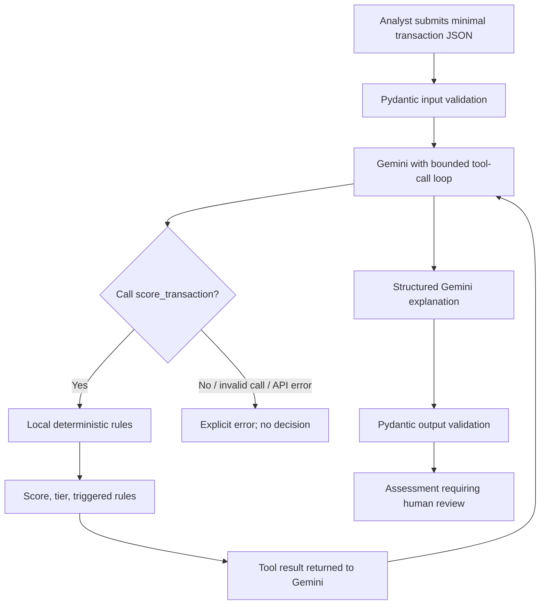

# Fraud Detection Triage Agent

This is a standalone Python project. Its dependencies are declared in
`requirements.txt`, and its setup script creates a project-local `.venv`.
Nothing in this project imports or runs code from sibling folders.

The starter uses the Google GenAI SDK and Pydantic. A deterministic local
function calculates a heuristic score and tier; Gemini explains the results
using structured output. It is an analyst-support prototype, not an automated
fraud decision system. Every assessment requires human review.

## Project layout

```text
agentic_project/
├── .env.example
├── .gitignore
├── .vscode/
│   └── settings.json
├── fraud_agent.py
├── requirements.txt
├── setup.ps1
└── tests/
    └── test_fraud_agent.py
```

## Setup on Windows

Install Python 3.11 or later and the Python launcher (`py`) if they are not
already installed. Open PowerShell in this folder and run:

```powershell
powershell -NoProfile -ExecutionPolicy Bypass -File .\setup.ps1
```

The script creates `.venv` inside this project and installs the dependencies
from this project's `requirements.txt`. The policy override applies only to
that PowerShell process; it does not change your machine's execution policy.
Activate the environment when using the terminal:

```powershell
.\.venv\Scripts\Activate.ps1
```

VS Code is configured to use `.venv\Scripts\python.exe` as this project's
interpreter. Open `agentic_project` as the workspace folder, then run
`setup.ps1` before running or testing the application.

## Gemini API key

The API key previously pasted into this project's README must be considered
compromised. Revoke it in Google AI Studio and create a replacement. Do not
commit API keys or transaction data.

Copy the example environment file and replace the placeholder with your
**newly rotated** key locally:

```powershell
Copy-Item .env.example .env
```

Edit `.env` and replace `replace_with_your_rotated_key` on the
`GOOGLE_API_KEY` line with your new key. The `.env` file is ignored by Git;
do not paste your key into chat or commit it.
`GEMINI_MODEL` defaults to `gemini-2.5-pro` and can be changed to any model
available to your Google AI Studio project.

## Run

Pass a minimal transaction object as JSON:

```powershell
'{"amount":1250,"currency":"USD","known_device":false,"unusual_location":true,"transactions_last_hour":3,"account_age_days":2}' |
  .\.venv\Scripts\python.exe .\fraud_agent.py
```

Run the offline unit tests:

```powershell
.\.venv\Scripts\python.exe -m pytest
```

## Agent control loop

This is a bounded tool-using ReAct loop: validate input, ask Gemini to invoke
the local `score_transaction` tool, return deterministic rule evidence to
Gemini, and validate its final explanation with Pydantic. The score and tier
come only from local rules and are not changed by the model.



## Before production

The sample rules and thresholds are placeholders. Validate them with fraud
experts and representative, appropriately governed data. Evaluate false
positives and negatives, subgroup impacts, and analyst overrides. Add
authentication, authorization, rate limiting, secure audit logging, data
retention controls, monitoring, and an analyst review workflow before
operational use. Never send card numbers, credentials, or unnecessary personal
data to the model.
